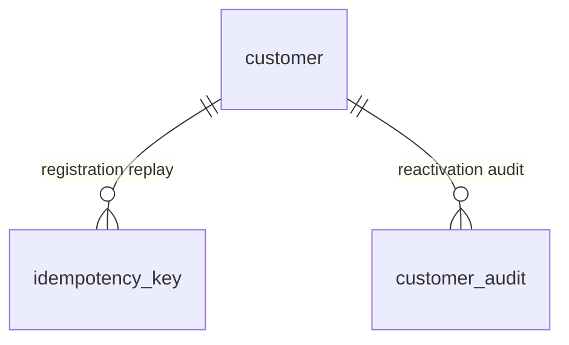

# synkro-customers-db

> Customers schema migrations, roles and permissions for the shared PostgreSQL instance.

Part of the **SynkroTech SAS Sales Management System**. Architecture, decisions and
contracts live in [synkro-docs](https://github.com/code-corhuila/synkro-docs).

**Quick start:** with the instance healthy and migration credentials supplied, run the `customers-db-migrate` tooling service from this root. See [Getting started](#getting-started).

## What it does

- Owns customers_schema, customer records, idempotency and reactivation audit structures.
- Versions Flyway migrations and explicit reader/writer grants.
- Provides folded search columns and additive contact/search/reactivation migrations.
- Keeps historical customer data intact; contact CHECK activation remains separately gated.

## Where it fits



synkro-infra-postgres owns the instance, volume and customers_app login. This repository owns only its schema, permissions and migration runner.

## Tech stack

| Component | Choice |
|---|---|
| Engine | PostgreSQL 16 |
| Migrations | Flyway 10.20.1 |
| Runner | customers-db-migrate; tooling profile |
| Tests | Node.js 20.11+; real disposable PostgreSQL |

## Dependencies

| Depends on | Purpose | Configuration |
|---|---|---|
| synkro-infra-postgres | Database, login and lifecycle | platform network |
| Administrative credentials | Deliberate schema migration | FLYWAY_*; protected-file override supported |

## Getting started

From this repository root in **PowerShell or Bash**, with infrastructure and the login already prepared:

```text
docker compose --env-file env/dev.env -f deploy/compose.yml run --rm -T customers-db-migrate migrate
docker compose --env-file env/dev.env -f deploy/compose.yml run --rm -T customers-db-migrate validate
```

Create `env/dev.env` from its committed example and supply protected migration inputs first. The optional `deploy/compose.secrets.yml` override mounts a protected password file. QA/main migration requires a verified backup.

For the complete platform, start from [synkro-infra-postgres](https://github.com/code-corhuila/synkro-infra-postgres).

## Configuration

The committed [.env.example](.env.example) is the configuration inventory.
Its values are examples; required inputs and defaults follow its comments and the
owning implementation. Keep real secrets in protected local files.

| Variable | Purpose |
|---|---|
| `COMPOSE_PROJECT_NAME` | Explicit environment project identity |
| `PLATFORM_NETWORK` | Docker network selection |
| `FLYWAY_URL` | Connection address, origin or build-time entry point |
| `FLYWAY_USER` | Connection or administrator identity |
| `FLYWAY_PASSWORD` | Credential supplied locally |
| `FLYWAY_PASSWORD_FILE` | Protected credential file path |
| `CUSTOMERS_DB_ADMIN_PASSWORD_FILE` | Protected credential file path |
| `CUSTOMERS_FLYWAY_URL` | Connection address, origin or build-time entry point |
| `DB_ADMIN_USER` | Connection or administrator identity |

## Interface

| Structure | Responsibility |
|---|---|
| customer | Customer identity, contacts, search columns and active state |
| idempotency_key | Registration replay ownership |
| customer_audit | Reactivation audit |
| customers_reader / customers_writer | Explicit owning grants; no DELETE/TRUNCATE/DDL |
| customers_schema.flyway_schema_history | Domain-owned migration ledger |

V008–V014 are additive. The contact-required CHECK remains in pending activation tooling; the API currently enforces required contacts. No historical contact values are fabricated or backfilled.

## Project structure

```text
01_ddl/         schema, customer/audit tables, search and indexes
02_dml/         approved data changes
03_dcl/         explicit roles and grants
04_tcl/         transactional operations
05_rollbacks/   matching U reversions
deploy/         tooling runner and optional secret-file override
scripts/        migration guard, inventory and pending activation
tests/          contract and real-engine verification
```

## Testing

```text
node --test tests/contract.test.mjs
node --test --test-concurrency=1 tests/integration.test.mjs
```

The real-engine suite creates isolated resources and rejects external database targets. Docker images must be available. Historical reconstruction/recovery procedures remain in the guides below.

## Branching and contributing

Use a `feat/`, `fix/` or `chore/` child branch and a PR into `develop`.
Permanent branches are `develop`, `qa` and `main`; none accepts direct commits.
Promote through a `qa-<description>` or release child with `git cherry-pick -x`.
`main` requires approval from `ariel5253`. Use English Conventional Commits.
See [Git conventions](https://github.com/code-corhuila/synkro-docs/blob/main/00-governance/git-conventions.md).

## Further documentation

- [Original Customers schema delivery](https://github.com/code-corhuila/synkro-docs/issues/244).
- [Model and permissions](docs/model-and-permissions.md).
- [Migrations](docs/migrations.md).
- [Root composition](docs/root-composition.md).
- [Testing and recovery](docs/testing-and-recovery.md).
- [Contact rollout](docs/contact-rollout.md).
- [Domain rules](https://github.com/code-corhuila/synkro-docs/blob/main/02-domain/entities-and-rules.md), [contracts](https://github.com/code-corhuila/synkro-docs/tree/main/07-api/contracts/openapi) and [testing strategy](https://github.com/code-corhuila/synkro-docs/blob/main/11-quality/testing-strategy.md).

<!-- Preserve previously published README section links. -->
<a id="modelo-y-permisos"></a>
<a id="ejecución"></a>
<a id="composición-externa"></a>
<a id="pruebas-y-recuperación"></a>
<a id="hu-cli-05-contactos-obligatorios-búsqueda-y-reactivación"></a>
<a id="branching"></a>
